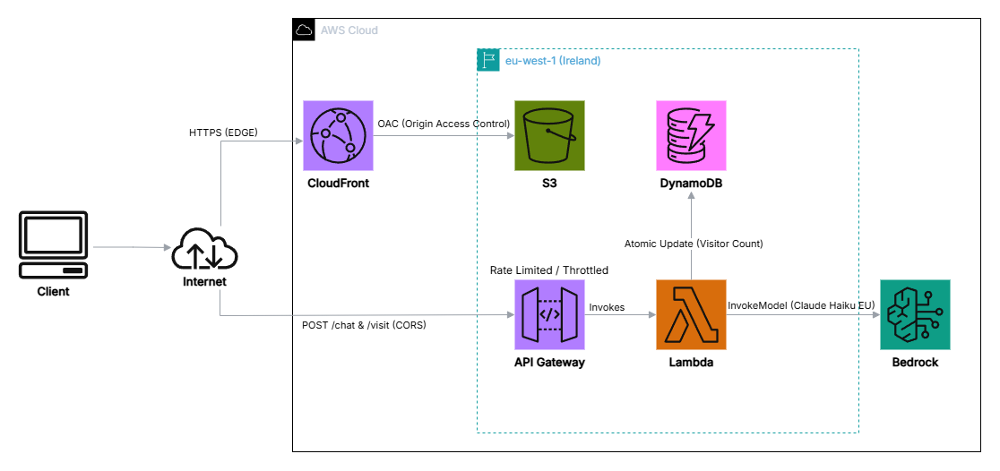

# ☁️ Serverless Cloud Portfolio & GenAI CV Assistant on AWS

🌐 **Live Demo:** [https://TU-URL-DE-CLOUDFRONT.net](https://TU-URL-DE-CLOUDFRONT.net)

A 100% serverless personal portfolio and interactive AI assistant built on **AWS (`eu-west-1`)** using Infrastructure as Code (**AWS SAM**). Designed to demonstrate cloud architecture patterns, security best practices, and practical Generative AI integration.

---

## 🏗️ Architecture

### Request Flow
1. **Static Edge Delivery:** Users access the frontend over HTTPS via **Amazon CloudFront**. Static assets (`index.html`) are stored in a private **Amazon S3** bucket with all public access blocked, accessible strictly through CloudFront **Origin Access Control (OAC)**.
2. **Serverless API Layer:** Asynchronous `POST /visit` and `POST /chat` requests are routed through **Amazon API Gateway** (HTTP API) with CORS and rate-limiting enabled.
3. **Compute & Orchestration:** **AWS Lambda** (Python 3.12 / `boto3`) processes incoming requests under strict least-privilege IAM roles:
   - `/visit`: Performs atomic counter updates in **Amazon DynamoDB**.
   - `/chat`: Injects CV context in-memory and invokes **Amazon Bedrock** (`eu.anthropic.claude-haiku-4-5`) via an EU Cross-Region Inference profile.

---

## 🛡️ AWS Well-Architected Highlights

* **Security:**
  * **Zero-Secret CI/CD:** Automated deployments via **GitHub Actions** using **AWS IAM OpenID Connect (OIDC)** federation—no static long-lived AWS credentials stored in GitHub.
  * **Private Storage:** S3 bucket secured with Origin Access Control (OAC).
  * **API Protection:** API Gateway configured with throttling (`RateLimit: 5 req/s`, `BurstLimit: 10`) to prevent DDoS and LLM token exhaustion.
  * **GDPR Data Residency:** Bedrock calls use the `eu.` inference profile, ensuring prompts and completions remain strictly within European Union AWS regions.
* **Operational Excellence:**
  * **Infrastructure as Code (IaC):** Entire stack declaratively defined in `template.yaml` using **AWS SAM**.
  * **Distributed Tracing:** **AWS X-Ray** (`Tracing: Active`) enabled across API Gateway and Lambda to monitor end-to-end latency to DynamoDB and Bedrock.
* **Cost Optimization:**
  * **Serverless Pay-Per-Use:** Zero idle compute costs; leverages AWS *Always Free* tier allowances for CloudFront, Lambda, DynamoDB, and X-Ray.
  * **In-Memory Context Injection:** CV context is packaged directly within the Lambda deployment artifact, eliminating redundant S3 `GetObject` calls and latency on every chat request.
  * **Cost Guardrails:** Monitored via **AWS Budgets** with automated billing alerts set at a **$1.00 USD** threshold.

---

## 🛠️ Tech Stack

* **Cloud & IaC:** AWS (S3, CloudFront, API Gateway, Lambda, DynamoDB, Bedrock, IAM OIDC, X-Ray, Budgets), AWS SAM
* **Backend:** Python 3.12 (`boto3`)
* **Frontend:** HTML5, CSS3, Vanilla JavaScript (zero framework overhead)
* **CI/CD:** GitHub Actions

---

## 📬 Contact

* **Author:** Javier Monedero Angulo — BSc Information Systems Engineering Student at UPM (Madrid)
* **LinkedIn:** [linkedin.com/in/javier-monedero-angulo-798248445](https://www.linkedin.com/in/javier-monedero-angulo-798248445)
* **Email:** [javier.monedero@outlook.com](mailto:javier.monedero@outlook.com)